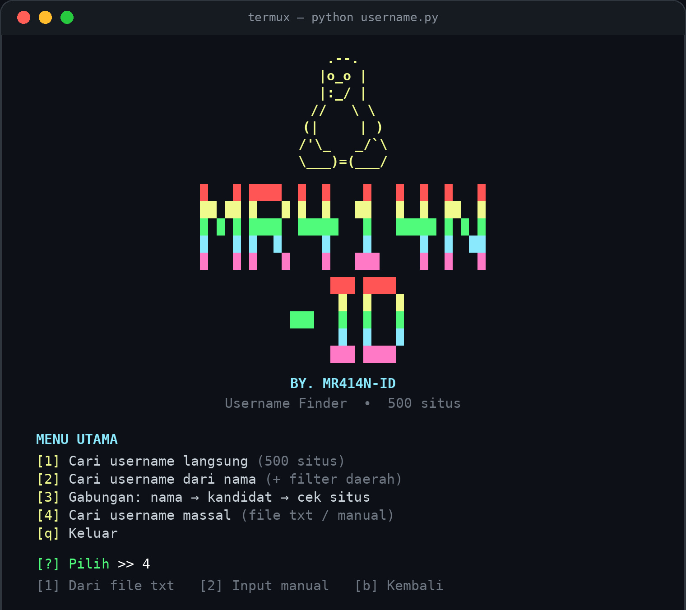

<div align="center">


<br/>


**Cari username di 500 situs dan media sosial sekaligus, langsung dari terminal.**

</div>

---

## ✨ Fitur

- 🔎 Mengecek **500 situs** (media sosial, developer, game, musik, marketplace, dll.)
- 🧭 **4 mode** dalam satu menu: cari langsung, dari nama, gabungan, dan **massal**
- 📂 **Pencarian massal**: banyak username sekaligus dari file `.txt` atau input manual
- ⚡ Cepat, memakai **40 thread** paralel
- 🎯 Hasil jelas: `[sukses]` + link profil
- 🛡️ Anti hasil palsu: dites ulang dengan username acak untuk membuang situs yang selalu membalas "ada"
- ✅ Penyimpanan hasil massal **hanya setelah persetujuan** (`y/n`)
- 🎨 Tampilan terminal berwarna dengan banner Tux ala Linux
- 📱 Ramah **Termux** (layar sempit otomatis menyesuaikan)

## 🖼️ Tampilan

<div align="center">
  
  <br/>
  <sub>Contoh tampilan menu utama</sub>
</div>

## 📦 Instalasi

### Termux (Android)

```bash
pkg update && pkg upgrade -y
pkg install python git -y
git clone https://github.com/MR414N-ID/Username
cd Username
pip install -r requirements.txt
```

### Linux / macOS / Windows

```bash
git clone https://github.com/MR414N-ID/Username
cd Username
pip install -r requirements.txt
```

## 🚀 Cara Pakai

```bash
python username.py
```

Atau langsung cek satu username lewat argumen:

```bash
python username.py mayor_tedy
```

### Menu

| Menu | Mode | Keterangan |
|:---:|---|---|
| **1** | Cari username langsung | Cek satu username di 500 situs. Hasil otomatis tersimpan ke `hasil_<username>.txt` |
| **2** | Cari darinamaa | Buat variasi username dari nama (+ filter daerah), cek di situs prioritas, lalu pilih kandidat secara manual |
| **3** | Gabungan | Nama → kandidat → otomatis cek 500 situs untuk tiap kandidat |
| **4** | **Massal** | Cari banyak username sekaligus (file txt / input manual) |
| **q** | Keluar | |

### 📂 Mode 4: Pencarian Massal

**Dari file txt**

1. Siapkan file `.txt`, satu username per baris (letakkan di folder yang sama dengan `username.py`):

   ```
   mayor_tedy
   @budi123
   siti.rahma
   ```

2. Pilih menu **4 → 1**, lalu ketik nama filenya (misalnya `list.txt`, boleh juga path lengkap seperti `/sdcard/list.txt`).

Baris kosong dan tanda `@` dibuang otomatis, sedangkan username kembar atau yang mengandung spasi dilewati.

**Input manual**

1. Pilih menu **4 → 2**, lalu ketik username.
2. Pilih **1** untuk menambah username lagi, atau **2** untuk selesai dan lanjut mencari.

**Setelah daftar siap**

1. Tampil daftar username dan total pengecekan, lalu konfirmasi `Mulai pencarian? (y/n)`.
2. Setelah selesai, tampil ringkasan `username : jumlah situs`.
3. Terakhir ditanya `Simpan hasil ke hasil_massal.txt? (y/n)`. Kalau `n`, tidak ada file yang dibuat.
4. Tekan `Ctrl+C` kapan saja untuk berhenti, hasil yang sudah selesai tetap ditampilkan.

> ⏳ Tiap username dicek ke 500 situs. Daftar yang panjang bisa memakan waktu lama dan situs tertentu bisa membatasi permintaan.

Contoh hasil:

```
[sukses] tiktok: https://www.tiktok.com/@mayor_tedy
[sukses] instagram: https://www.instagram.com/mayor_tedy/

============================================
RINGKASAN PENCARIAN MASSAL
============================================
mayor_tedy             : 12 situs
siti.rahma              : 3 situs
============================================
Total: 2 username, 15 jejak akun
```

## ➕ Menambah Situs

Buka `username.py`, lalu tambahkan satu baris di dalam `SITES_TEXT` dengan format:

```
namasitus https://contoh.com/{u}
```

`{u}` akan diganti otomatis dengan username yang dicari.

## ⚠️ Catatan

- Situs yang memuat halaman lewat JavaScript atau memblokir bot (misalnya Instagram, Facebook, LinkedIn) bisa memberi hasil kurang akurat.
- Pola URL situs bisa berubah sewaktu-waktu. Kalau ada yang meleset, silakan buat *issue* atau *pull request*.
- Hasil pencarian dari nama (menu 2 dan 3) hanya **tebakan** berdasarkan kemiripan username, bukan bukti bahwa akun itu milik orang yang dimaksud.

## ⚖️ Disclaimer

Tools ini dibuat untuk keperluan **OSINT yang sah dan edukasi**, misalnya mengecek jejak username milik sendiri atau riset keamanan yang diizinkan. Jangan dipakai untuk melacak, melecehkan, menguntit, atau membongkar data pribadi orang lain tanpa izin. Penulis tidak bertanggung jawab atas penyalahgunaan. Gunakan dengan bijak dan patuhi hukum serta aturan setiap situs.

## 👤 Author

<div align="center">

**BY. MR414N-ID**

⭐ Kalau berguna, kasih bintang di repo ini ya!

</div>
